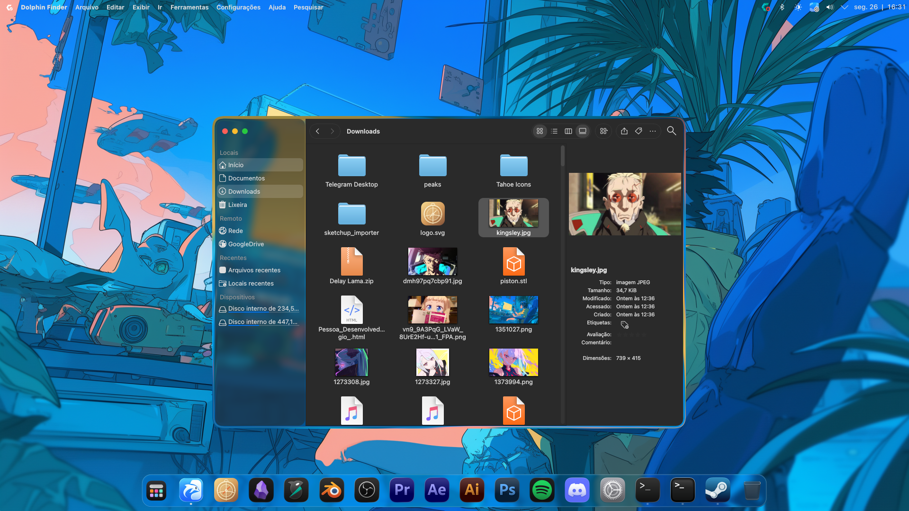
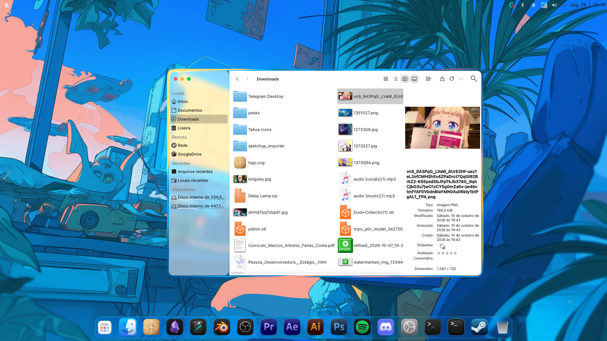

# Dolphin Finder

**Dolphin Finder** is an independent file manager with a macOS/Finder-inspired interface for KDE Plasma, especially on CachyOS.

It keeps Dolphin's file-management features while redesigning the window chrome:

- Finder-style Places sidebar integrated with the window controls.
- Sidebar window controls rendered from the active KWin Aurorae SVG theme, with system-style icons as a fallback for other decorations.
- Theme-provided hover, pressed and inactive states, plus a restore button when maximized.
- Frameless rounded window with KWin blur/transparency support.
- Floating toolbar controls inspired by macOS Tahoe Finder.
- Back/forward navigation, view settings, split view, search, and other toolbar actions arranged in the Finder-style header.
- Compact icon grid with 64 px icons, reduced horizontal item width, and increased vertical spacing.
- Selection markers disabled in the Finder profile.
- Dedicated application identity, icon and isolated configuration profile.

## Showcase

### Details view with Finder-style preview



### Icon view with the Places sidebar



The application icon is `src/Dolphin.png`.

## Project status

This is a personal UI customization and an experimental fork, not an official
KDE project. It is based on KDE Dolphin 26.08.2. The interface is tailored to
the author's Plasma/KWin setup and may require adjustments on other KDE or Qt
configurations.

The visual effects depend on the KWin compositor. The project does not bundle
the external Kvantum theme or MacTahoe icon theme; those can be installed
separately and selected through the user's KDE/GTK settings.

The interface is compatible with KDE/KWin visual effects and can be used with
third-party compositor effects such as **Glass Refraction** and **Glass**, when
those effects are installed and enabled in the user's Plasma configuration.
The exact blur, refraction, transparency and glass appearance depends on the
active compositor and its settings.

## Installation

This project is intended to be installed through the included interactive
installer. Users do **not** need to configure or build the project manually.

On CachyOS, clone the repository and run:

```sh
git clone https://github.com/marcosfantonio/dolphin-finder-tahoe.git dolphin-finder
cd dolphin-finder
./install.sh --install-deps
```

The installer builds the application internally, installs it under the user's
home directory and creates the **Dolphin Finder** application entry. It does
not require or configure another file manager.

It also records the installed repository commit. When run again from a newer
checkout, it shows the installed and available commits and asks whether the
application should be updated. Answer `n` to keep the current installation.

During installation it asks whether directory links should open with Dolphin
Finder. The default answer is **No**.

Explicit choices are also supported:

```sh
./install.sh --no-default
./install.sh --default
```

After installation, launch **Dolphin Finder** from the application menu or run
`dolphin-finder` in a terminal.

## Uninstallation

Run the included uninstaller from the repository:

```sh
./uninstall.sh
```

It removes the user installation, launcher, icon and isolated profile without
changing other applications. If Dolphin Finder was the default file manager,
select a replacement in System Settings after uninstalling.

## Installation profile

The installer uses a separate user profile under:

```text
~/.local/share/dolphin-finder
```

Setting Dolphin Finder as the default file manager is an explicit user decision.

## Upstream and licensing

This project is based on [KDE Dolphin](https://invent.kde.org/system/dolphin),
release 26.08.2. The original copyright notices and license files are retained
in this repository. See `COPYING`, `COPYING.DOC`, and `LICENSES/` for details.
