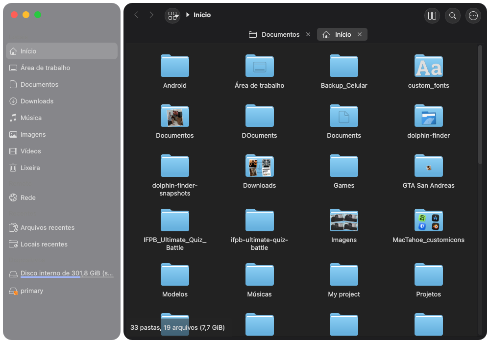

# Dolphin Finder

**Dolphin Finder** is a customized KDE Dolphin fork that brings a macOS/Finder-inspired interface to KDE Plasma, especially on CachyOS.

It keeps Dolphin's file-management features while redesigning the window chrome:

- Finder-style Places sidebar integrated with the window controls.
- macOS traffic-light buttons for close, minimize, and maximize/restore.
- Individual hover symbols on the traffic-light buttons.
- Frameless rounded window with KWin blur/transparency support.
- Floating toolbar controls inspired by macOS Tahoe Finder.
- Back/forward navigation, view settings, split view, search, and other toolbar actions arranged in the Finder-style header.
- Compact icon grid with 64 px icons, reduced horizontal item width, and increased vertical spacing.
- Selection markers disabled in the Finder profile.
- Separate application profile so the system Dolphin remains untouched unless the user explicitly chooses otherwise.

## Screenshot

This is a real screenshot of the customized Dolphin Finder running on KDE Plasma:



The repository also includes the optional application icons used by the installer:

- `Dolphin.png` — themed Dolphin icon.
- `finder.png` — macOS Finder-style icon.

## Project status

This is a personal UI customization and an experimental fork, not an official
KDE project. It is based on KDE Dolphin 26.08.2. The interface is tailored to
the author's Plasma/KWin setup and may require adjustments on other KDE or Qt
configurations.

The visual effects depend on the KWin compositor. The project does not bundle
the external Kvantum theme or MacTahoe icon theme; those can be installed
separately and selected through the user's KDE/GTK settings.

## Building

The source uses the standard KDE CMake build system. On CachyOS/Arch Linux,
install the Qt 6, KDE Frameworks 6, Baloo, CMake, Ninja, and compiler
dependencies, then build with:

```sh
cmake -S . -B build -G Ninja \
  -DCMAKE_BUILD_TYPE=RelWithDebInfo \
  -DBUILD_TESTING=OFF
cmake --build build --parallel 2
```

The custom executable is produced at `build/bin/dolphin`.

## Installation profile

The intended launcher uses a separate user profile under:

```text
~/.local/share/dolphin-finder
```

The original `/usr/bin/dolphin` and its global configuration are not replaced
by the project. Setting Dolphin Finder as the default file manager should be
an explicit user decision.

## Upstream and licensing

This project is based on [KDE Dolphin](https://invent.kde.org/system/dolphin),
release 26.08.2. The original copyright notices and license files are retained
in this repository. See `COPYING`, `COPYING.DOC`, and `LICENSES/` for details.
